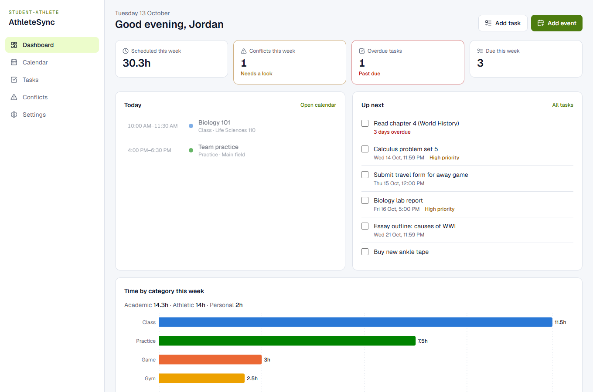
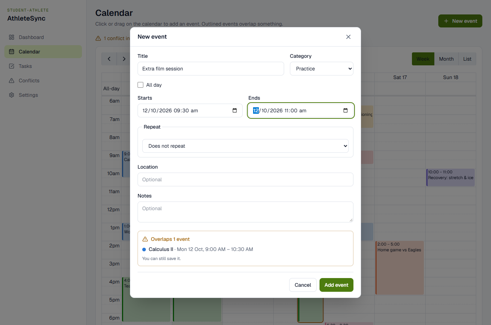
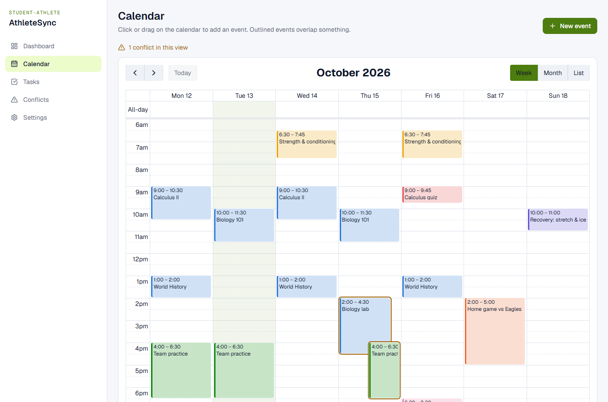
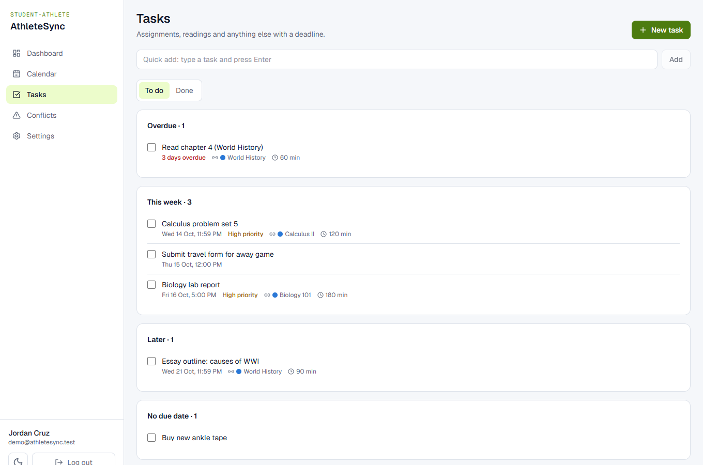
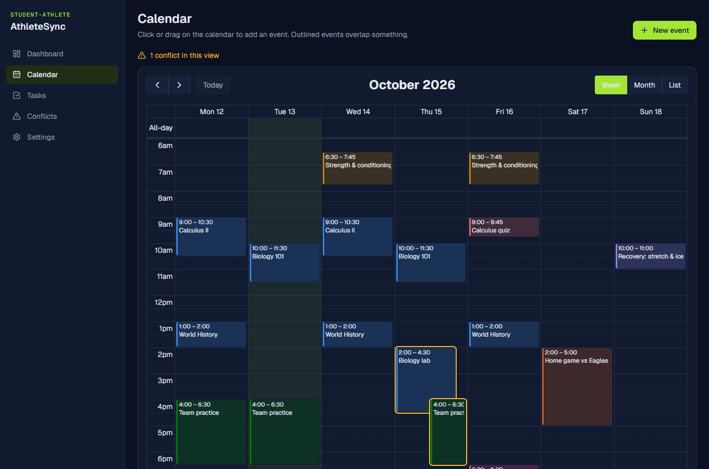
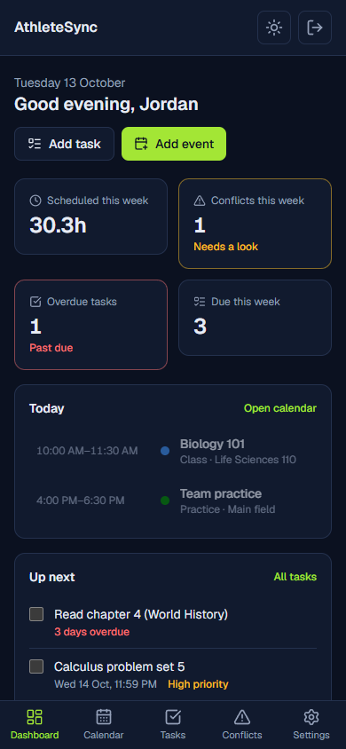

# AthleteSync

**One schedule for student-athletes.** Classes, exams, practices, games, gym sessions, recovery and deadlines live in one calendar, and AthleteSync warns you when your academic and athletic commitments collide, including between repeating events, before you save them.



## Features

- **Calendar** with week, month and list views. Click or drag to add an event. Repeating events (e.g. "Mon/Wed until December") keep their local time across daylight-saving changes.
- **Conflict detection.** Overlapping events are outlined on the calendar and listed on a Conflicts page. While you fill in a new event, a live preview tells you what it would clash with ("Overlaps Calculus II on 26 dates") before you save.
- **Tasks and deadlines** grouped into Overdue / Today / This week / Later, linkable to a class, with priority and time estimates.
- **Dashboard** with this week's scheduled hours, conflicts, overdue and upcoming tasks, today's agenda, and time by category (academic vs athletic).
- Light and dark mode, phone-friendly layout, keyboard- and screen-reader-friendly forms and dialogs.

| Conflict preview while adding an event | Conflicts in the week view |
|---|---|
|  |  |

| Tasks | Dark mode | Phone |
|---|---|---|
|  |  |  |

## Stack

| Layer | Tech |
|---|---|
| Frontend | React 19, Vite, Tailwind CSS v4, React Router 8, TanStack Query 5, FullCalendar 7, Recharts 3 |
| Backend | Laravel 12 (PHP 8.2+), Sanctum SPA cookie auth, rlanvin/php-rrule |
| Database | MySQL 8 |
| Tests | PHPUnit feature tests (63), Playwright end-to-end smoke test |

## How it works

**Time.** Every timestamp is stored in UTC. Each event also stores the IANA timezone it was created in (e.g. `Asia/Manila`), and repeating events are expanded in that timezone, so a 9:00 class stays at 9:00 when clocks change. The frontend always sends exact UTC instants; dates sent without an offset are read in the user's timezone.

**Repeating events** are stored once, as an [RFC 5545 RRULE](https://datatracker.ietf.org/doc/html/rfc5545#section-3.3.10) (`FREQ=WEEKLY;BYDAY=MO,WE;UNTIL=…`), and expanded on demand for the requested date range. Each event also stores when its series ends (`series_ends_at`), so range queries skip finished series without expanding them. Only daily to yearly rules are accepted, and a finite series is capped at 1,000 occurrences.

**Conflict detection** (`app/Services/ConflictDetector.php`) sorts occurrences by start time and compares each one only with those that start before it ends: a sweep line, O(n log n + overlapping pairs) instead of comparing every pair. All-day events (e.g. "Midterm exams") and back-to-back events (one ends at 10:00, the next starts at 10:00) never conflict. Conflicts are warnings; you can still save.

**Auth.** Sanctum's SPA mode: the Vite dev server proxies `/api` and `/sanctum` to Laravel, so the browser sees one origin and authenticates with an HTTP-only session cookie plus a CSRF token. No API tokens are stored in the browser. Users only ever see their own data; another user's event or task answers 404, so IDs don't reveal what exists.

**Accessible colors.** The eight category colors were checked with a palette validator for lightness, colorblind separation and contrast, separately for light and dark mode. No set of eight colors stays distinct for every reader, so a category's name always appears next to its color.

## API

All routes are under `/api/v1` and return JSON (`{ "data": … }`). Everything except `health`, `register` and `login` requires a signed-in session.

| Method & path | Purpose |
|---|---|
| `GET /health` | API and database status |
| `POST /auth/register` · `POST /auth/login` · `POST /auth/logout` | Account and session (register/login: 6 tries per minute) |
| `GET /auth/user` · `PATCH /auth/user` | Current user; update name and timezone |
| `POST /events` · `GET/PATCH/DELETE /events/{id}` | Event definitions (a repeating event is one record) |
| `GET /calendar?from&to` | Occurrences in a range, repeating events expanded, sorted |
| `GET /conflicts?from&to` | Every overlapping pair in a range |
| `POST /conflicts/preview` | What a proposed event would clash with (repeating: next 180 days); `event_id` ignores the stored version when editing |
| `GET /tasks?status=open\|completed` · `POST /tasks` · `GET/PATCH/DELETE /tasks/{id}` | Tasks; `PATCH {completed: true}` ticks one off |
| `GET /stats?from&to` | Minutes per category, conflict count, task counts |

## Running it locally (Windows)

Prerequisites: PHP 8.2+ with `pdo_mysql`, Composer, Node 20+, MySQL 8+ on port 3306, and Google Chrome for the end-to-end test.

```powershell
# 1. Backend dependencies and environment
cd backend
composer install
copy .env.example .env        # then set DB_PASSWORD to a strong password
php artisan key:generate
cd ..

# 2. Create the databases and the 'athletesync' MySQL user (asks for the MySQL root password)
powershell -ExecutionPolicy Bypass -File scripts\setup-database.ps1

# 3. Tables and demo data, then start the API
cd backend
php artisan migrate
php artisan db:seed --class=DemoSeeder   # optional: a full demo week
php artisan serve                        # http://127.0.0.1:8000

# 4. Frontend (second terminal)
cd frontend
npm install
npm run dev                              # http://localhost:5173
```

Open http://localhost:5173 and create an account, or log in as **demo@athletesync.test** / **demo-password** if you seeded the demo. The demo week is generated around the current date (set `DEMO_TIMEZONE` before seeding if you're not in `Asia/Manila`), and rerunning the seeder resets it. If something isn't connecting, http://localhost:5173/setup checks the API and database.

**Slow responses (about 1 s per request)?** XAMPP's PHP ships with OPcache off, so every request recompiles the framework. In `C:\xampp\php\php.ini`, enable `zend_extension=opcache` and set `opcache.enable_cli=1`, then restart `php artisan serve`.

## Tests

```powershell
cd backend
php artisan test            # 63 feature tests against the athletesync_testing database

cd frontend
npm run lint                # oxlint
npm run e2e                 # needs both servers running and the demo seeded
npm run screenshots         # same checks, and refreshes docs/screenshots
```

The backend tests cover auth, validation, ownership (other users' data answers 404), timezone handling, recurrence across daylight-saving changes, range queries, conflict detection, the preview window, tasks and stats. The end-to-end test drives the real app in Chrome as the demo user: it logs in, uses every page in light and dark mode and at phone width, previews a conflicting event without saving it, and fails on any console error or failed request.

## Deploying (Vercel + Railway)

Vercel hosts the React app; Laravel and MySQL run on [Railway](https://railway.com), because Vercel has no official PHP runtime or MySQL. Vercel forwards `/api/*` and `/sanctum/*` to Railway ([frontend/vercel.json](frontend/vercel.json)), so the browser sees a single site and session cookies work exactly as in local development. The frontend needs no environment variables.

**1. Backend on Railway**

1. On railway.com, sign in with GitHub: **New Project → Deploy from GitHub repo → athletesync**.
2. In the new service's **Settings**, set:
   - **Root Directory:** `/backend`
   - **Pre-deploy Command:** `php artisan migrate --force`
   - **Healthcheck Path:** `/api/v1/health`
   - **Watch Paths:** `/backend/**`
   - **Restart Policy:** On Failure

   Railway builds Laravel automatically with Railpack. These settings live on the service, not in a config file, because Railway no longer accepts `railway.json` for new projects.
3. **+ Create → Database → MySQL** in the same project. Keep the service name `MySQL`, because the variables below reference it by name.
4. Generate an app key locally: `php artisan key:generate --show`. Use a new key; don't reuse your local one.
5. In the backend service's **Variables → Raw Editor**, paste the following and fill in the two placeholders. Until step 3 of the Vercel section, use `athletesync.vercel.app` as a guess for your Vercel domain.

   ```
   APP_NAME=AthleteSync
   APP_ENV=production
   APP_DEBUG=false
   APP_KEY=<output of key:generate --show>
   APP_URL=https://<your-vercel-domain>
   FRONTEND_URL=https://<your-vercel-domain>
   SANCTUM_STATEFUL_DOMAINS=<your-vercel-domain>
   SESSION_DRIVER=database
   SESSION_SECURE_COOKIE=true
   CACHE_STORE=database
   QUEUE_CONNECTION=database
   LOG_CHANNEL=stderr
   LOG_LEVEL=warning
   RAILPACK_SKIP_MIGRATIONS=true
   DB_CONNECTION=mysql
   DB_HOST=${{MySQL.MYSQLHOST}}
   DB_PORT=${{MySQL.MYSQLPORT}}
   DB_DATABASE=${{MySQL.MYSQLDATABASE}}
   DB_USERNAME=${{MySQL.MYSQLUSER}}
   DB_PASSWORD=${{MySQL.MYSQLPASSWORD}}
   ```

   `RAILPACK_SKIP_MIGRATIONS` stops Railpack from also migrating and seeding on every container start, since migrations already run once per deploy.
6. **Settings → Networking → Generate Domain**. Open `https://<railway-domain>/api/v1/health`; it should show `"status":"ok","database":"connected"`.

**2. Frontend on Vercel**

1. In [frontend/vercel.json](frontend/vercel.json), replace both `YOUR-BACKEND.up.railway.app` with your Railway domain. Commit and push.
2. On vercel.com: **Add New → Project → import athletesync**. Set **Root Directory** to `frontend`; Vite and the build settings are detected automatically. Add no environment variables, then click **Deploy**.
3. If Vercel's domain differs from the one you guessed in Railway, update `APP_URL`, `FRONTEND_URL` and `SANCTUM_STATEFUL_DOMAINS` there. Railway redeploys on variable changes.

**3. Check it works**

On the Vercel URL:
- Sign up, add a repeating event and a task.
- Refresh while on `/calendar`; it should reload the page, not show a 404.
- Log out and back in.
- `https://<vercel-domain>/api/v1/health` should report the database as connected.

Optionally, add a demo account through Railway's shell: `php artisan db:seed --class=DemoSeeder --force`. Note that its login (`demo@athletesync.test` / `demo-password`) is public.

**After setup**, every push to `main` redeploys automatically. Vercel rebuilds the frontend, and Railway rebuilds the backend when files under `backend/` change. Vercel also builds a preview for every branch, but **login only works on the production domain**, the one listed in `SANCTUM_STATEFUL_DOMAINS`.

## Repository layout

```
athletesync/
├── backend/            Laravel REST API (/api/v1)
│   ├── app/Services/   Recurrence expansion, calendar ranges, conflict detection
│   └── tests/Feature/  API tests
├── frontend/           React SPA
│   ├── src/pages/      Dashboard, Calendar, Tasks, Conflicts, Settings, auth
│   └── e2e/            Browser smoke test
├── docs/screenshots/   Generated by `npm run screenshots`
└── scripts/            Local database setup
```

## Possible next steps

- Edit or skip a single date of a repeating event (RRULE exceptions), e.g. a cancelled practice.
- Drag and drop to reschedule on the calendar.
- Import class timetables and team schedules from iCalendar (`.ics`) feeds.
- Reminders before deadlines and events.
